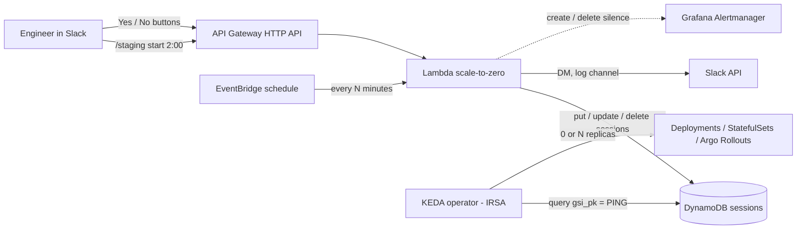
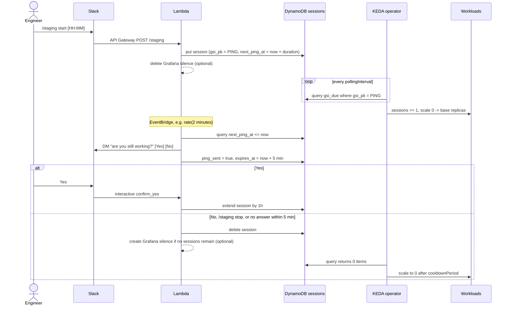
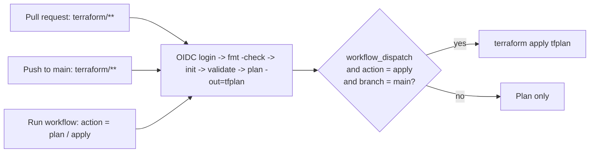

# KEDA Scale-to-Zero for non-production Kubernetes environments

Keep staging (or any shared non-prod environment) at **0 replicas** while nobody uses it, and bring it up on demand from Slack.

Engineers type `/staging start 2:00` in Slack → a session is written to DynamoDB → KEDA sees an active session and scales the workloads up. When the session ends, the bot asks *"are you still working?"*; no answer (or **No**) → the session is removed → KEDA scales everything back to zero. Optionally, Grafana alerts are silenced while the environment is down.

## Architecture



| Component | Location | Purpose |
|---|---|---|
| Lambda (Python 3.13, no extra deps) | `terraform/modules/scale_to_zero/lambda_src` | Slash commands, button callbacks, scheduled ping/expire, Grafana silence |
| DynamoDB table `<env>-<app>-scale-to-zero-sessions` | `terraform/modules/scale_to_zero/dynamodb.tf` | One item per user session; GSIs `gsi_due` and `gsi_expire` |
| API Gateway HTTP API, route `POST /<environment>` | `terraform/modules/scale_to_zero/api-gateway.tf` | Slack Request URL (slash command + interactivity) |
| EventBridge rule | `terraform/modules/scale_to_zero/eventbridge.tf` | Periodic check of due/expired sessions |
| IRSA role for `keda-operator` | `terraform/iam.tf` | Read-only DynamoDB access for KEDA |
| KEDA chart | `helm/keda` | KEDA 2.18.3 with IRSA annotation (and Istio annotations) |
| ScaledObjects for Deployments | `helm/scale-to-zero-deployment` | Any number of Deployments/StatefulSets per release |
| ScaledObject for Argo Rollouts | `helm/scale-to-zero-rollout` | Rollout-based services (CPU/cron triggers can be combined) |

### How scaling works

Every active session has `gsi_pk = "PING"`. KEDA's `aws-dynamodb` scaler counts items in index `gsi_due` with `gsi_pk = PING`:

```yaml
scalingModifiers:
  formula: |
    sessions == 0 ? 0 : (sessions > 1 ? sessions : 1)
```

- `0` active sessions → 0 replicas.
- `>= 1` active sessions → base replicas (configurable per target).

### Session lifecycle



1. `start [HH:MM]` – creates a session (default 1h, max 8h), sets `next_ping_at = expires_at = now + duration`. Any previous session of the same user is replaced. Grafana silence (if any) is removed.
2. EventBridge (e.g. `rate(2 minutes)`) – for sessions with `next_ping_at <= now` the bot sends a DM with **Yes / No** buttons and moves `expires_at` to `now + 5 min`. The session stays `PING`, so workloads keep running during the grace period.
3. **Yes** – session extended by 1h. **No** – session deleted.
4. No answer within the grace period – DM is updated to *"Session expired"*, a message is posted to the log channel, the session is deleted.
5. When the last session is deleted, a Grafana silence for all alerts is created (optional).

### Slack commands

| Command | Action |
|---|---|
| `/staging` or `/staging start` | Start a 1h session |
| `/staging start 2:30` | Start a session for 2h30m (format `HH:MM`, capped at 8h) |
| `/staging stop` | Delete your session |
| `/staging status` | Show remaining time |
| `/staging purge` | Delete **all** sessions (everyone) |

The command name and label are configurable (`slash_command`, `session_label`), so you can run several independent instances, e.g. `/staging` for the whole environment and `/jhub` for JupyterHub only (see `terraform/scale-to-zero-jhub.tf`).

## Repository layout

```
.
├── .github/workflows/terraform.yml   # plan on PR, apply on main (GitHub OIDC)
├── terraform/                        # AWS side (Terraform / OpenTofu)
│   ├── scale-to-zero.tf              # main instance (/staging)
│   ├── scale-to-zero-jhub.tf         # second, independent instance (/jhub)
│   ├── iam.tf                        # IRSA role + DynamoDB read policy for KEDA
│   ├── terraform.tfvars.example
│   ├── backend.hcl.example
│   └── modules/scale_to_zero/        # Lambda, DynamoDB, API Gateway, EventBridge, IAM, logs
└── helm/
    ├── keda/                         # KEDA operator
    ├── scale-to-zero-deployment/     # ScaledObjects for Deployments/StatefulSets
    └── scale-to-zero-rollout/        # ScaledObject for an Argo Rollout
```

## Prerequisites

- AWS account with an EKS cluster and an IAM OIDC provider for it (IRSA), see step 0.
- `aws` CLI, `kubectl`, `helm`, Terraform >= 1.6 or OpenTofu (AWS provider >= 6.6).
- Kubernetes access to the cluster (EKS access entry or `aws-auth`) with permissions to install charts.
- KEDA (installed via `helm/keda` or your own installation with IRSA on `keda-operator`).
- A Slack workspace where you can create an app.
- Optional: Argo Rollouts (for `helm/scale-to-zero-rollout`), Grafana with Alertmanager API (for auto-silence).

## Setup

### 0. Cluster access and OIDC provider

Terraform does **not** connect to Kubernetes: it only reads the EKS cluster and its OIDC provider through the AWS API. `kubectl`/`helm` (steps 4–5) need a kubeconfig:

```shell
export CLUSTER=staging-apps REGION=us-east-1

aws eks update-kubeconfig --name "$CLUSTER" --region "$REGION"
kubectl get nodes
```

If `kubectl` returns `Unauthorized`, your IAM identity has no access to the cluster. Ask a cluster admin to add an access entry:

```shell
aws eks create-access-entry --cluster-name "$CLUSTER" --principal-arn <YOUR_IAM_ROLE_ARN>
aws eks associate-access-policy --cluster-name "$CLUSTER" --principal-arn <YOUR_IAM_ROLE_ARN> \
  --policy-arn arn:aws:eks::aws:cluster-access-policy/AmazonEKSClusterAdminPolicy \
  --access-scope type=cluster
```

IRSA requires an IAM OIDC provider for the cluster. Check that it exists:

```shell
ISSUER_ID=$(aws eks describe-cluster --name "$CLUSTER" --region "$REGION" \
  --query "cluster.identity.oidc.issuer" --output text | awk -F/ '{print $NF}')
aws iam list-open-id-connect-providers | grep "$ISSUER_ID" || echo "OIDC provider is missing"
```

Missing? Create it (once per cluster):

```shell
eksctl utils associate-iam-oidc-provider --cluster "$CLUSTER" --region "$REGION" --approve
```

### 1. Slack app

The Slack part is done in two passes: create the bot now, and point it to AWS after `terraform apply` (step 3).

1. Open <https://api.slack.com/apps> → **Create New App** → **From scratch**. Enter a name (e.g. `Staging Bot`) and pick your workspace.
2. **OAuth & Permissions** → **Scopes** → **Bot Token Scopes** → add:

   | Scope | Why |
   |---|---|
   | `chat:write` | Send DMs with Yes/No buttons and messages to the log channel |
   | `im:write` | Open direct messages with users |
   | `commands` | Slash commands (added automatically when you create one in step 3) |

3. **App Home** → **Show Tabs** → enable **Messages Tab** (and *Allow users to send Slash commands and messages from the messages tab*), so DMs from the bot are shown properly.
4. **Install App** → **Install to Workspace** → **Allow**. In some workspaces a Slack admin has to approve the installation first (*Request to Install*).
5. Copy **Bot User OAuth Token** (`xoxb-...`) from **OAuth & Permissions**.
6. Log channel: create or choose a channel (e.g. `#staging-commands`), run `/invite @Staging Bot` in it, then open *channel name → View channel details* and copy the **Channel ID** at the bottom (`C0123456789`). This is `slack_log_channel_id`.
7. Store the token in SSM Parameter Store as a `SecureString`. Put the token into a local file first, so it doesn't end up in shell history:

   ```shell
   aws ssm put-parameter --type SecureString --name /staging/slack-bot/token --value file://token.txt
   rm token.txt
   aws ssm get-parameter --name /staging/slack-bot/token --query Parameter.ARN --output text   # -> ssm_slack_token_arn
   ```

   Use the parameter name as `ssm_slack_token_name` and the ARN as `ssm_slack_token_arn` in tfvars.

### 2. Terraform

```shell
cd terraform
cp terraform.tfvars.example inputs-staging.tfvars   # fill in values
cp backend.hcl.example backend.hcl                  # or remove backend "s3" {} from terraform.tf for local state
terraform init -backend-config=backend.hcl
terraform plan  -var-file=inputs-staging.tfvars
terraform apply -var-file=inputs-staging.tfvars
```

Outputs:

| Output | Used for |
|---|---|
| `keda_operator_role_arn` | `eks.amazonaws.com/role-arn` annotation of `keda-operator` |
| `scale_to_zero_invoke_url` | Slack Request URL for `/staging` |
| `scale_to_zero_ddb_table_name` | `tableName` in ScaledObjects |
| `scale_to_zero_jhub_*` | Same for the `/jhub` instance |

Only need one instance? Delete `scale-to-zero-jhub.tf`, the `scale_to_zero_jhub_*` outputs and the `module.scale_to_zero_jhub` entries in `iam.tf`.

`application` (default `keda`) is also the Kubernetes namespace used in the IRSA trust policy: `system:serviceaccount:<application>:keda-operator`.

### 3. Connect Slack to the API

Get the API Gateway URL created by Terraform:

```shell
terraform -chdir=terraform output -raw scale_to_zero_invoke_url
# https://abc123def4.execute-api.us-east-1.amazonaws.com/staging
```

The path at the end (`/staging`) is the `environment` value and is part of the URL. Use the full URL as is.

In the Slack app (<https://api.slack.com/apps> → your app):

1. **Slash Commands** → **Create New Command**:

   | Field | Value |
   |---|---|
   | Command | `/staging` (must match `slash_command`) |
   | Request URL | `scale_to_zero_invoke_url` |
   | Short Description | `Start/stop the staging environment` |
   | Usage Hint | `start [HH:MM] \| stop \| status \| purge` |

2. **Interactivity & Shortcuts** → turn **Interactivity** On → **Request URL** = the same `scale_to_zero_invoke_url` → **Save Changes**. This URL receives the **Yes / No** button clicks.
3. Slack shows a banner *"You've changed the permission scopes / slash commands... reinstall your app"*. Click **reinstall your app** (or **Install App** → **Reinstall to Workspace**). Without reinstalling, the command does not appear in Slack.
4. Check it in any channel:

   ```
   /staging status   ->  ❌ You don't have an active staging session
   /staging start 0:30
   /staging status   ->  ✅ Your staging session is active. Time left: 29 min
   /staging stop
   ```

   The log channel should show *"▶️ Staging started by @you for 30 min"* and *"🛑 Staging stopped by @you"*.

If there is no response (`/staging failed with the error "dispatch_failed"` or a timeout), check the Request URL and the Lambda logs:

```shell
aws logs tail /aws/lambda/staging-keda-scale-to-zero --follow
```

Second instance (`/jhub`): repeat with `scale_to_zero_jhub_invoke_url`. Slack allows only one Interactivity URL per app, so for independent **Yes / No** handling per instance use a separate Slack app (and SSM token) for each instance.

### 4. KEDA

The namespace must be equal to the Terraform variable `application` (default `keda`), and the service account must be `keda-operator`, otherwise the IAM role cannot be assumed (see [How KEDA authenticates to AWS](#how-keda-authenticates-to-aws-irsa)).

```shell
ROLE_ARN=$(terraform -chdir=terraform output -raw keda_operator_role_arn)

helm dependency update helm/keda
helm upgrade --install keda helm/keda -n keda --create-namespace \
  --set-string "keda.serviceAccount.operator.annotations.eks\.amazonaws\.com/role-arn=$ROLE_ARN"
```

Instead of `--set-string` you can put the ARN into `helm/keda/values.yaml`. Not using Istio? Remove `podAnnotations` from `values.yaml`.

**KEDA is already installed?** Add the annotation to the existing service account and restart the operator:

```shell
kubectl -n keda annotate sa keda-operator eks.amazonaws.com/role-arn="$ROLE_ARN" --overwrite
kubectl -n keda rollout restart deploy/keda-operator
```

If your KEDA lives in another namespace or uses another service account name, set `application` accordingly or adjust the `sub` condition in `terraform/iam.tf`.

### 5. Attach workloads

**Deployments / StatefulSets** – install one release per namespace:

```shell
helm upgrade --install mailpit-scale-to-zero helm/scale-to-zero-deployment \
  -n mailpit -f helm/scale-to-zero-deployment/examples/single-deployment.yaml
```

See `examples/multi-deployment.yaml` for several Deployments of one application. Per-target options: `kind`, `replicas` (base replicas while sessions exist), `minReplicaCount`, `maxReplicaCount`, `pollingInterval`, `cooldownPeriod`.

**Argo Rollouts**:

```shell
helm upgrade --install core-backend-scale-to-zero helm/scale-to-zero-rollout \
  -n core-backend -f helm/scale-to-zero-rollout/examples/service.yaml
```

The CPU trigger is enabled by default and works together with the DynamoDB trigger: with no sessions the Rollout goes to 0, with an active session CPU-based scaling applies between 1 and `maxReplicas`.

> The templates come from Helm charts that also render the workloads themselves. If you already have your own chart, copying `templates/*.yaml` into it is usually simpler than installing a separate release. `TriggerAuthentication` must exist in every namespace that has a ScaledObject.

**GitOps (Argo CD / Flux).** Commit the charts and values to your GitOps repository instead of running `helm` manually. KEDA (through the HPA it creates) owns `spec.replicas`, so either remove `replicas` from the workload manifests or ignore the field, otherwise Argo CD will keep scaling the workload back:

```yaml
# Argo CD Application / ApplicationSet
spec:
  ignoreDifferences:
    - group: apps
      kind: Deployment
      jsonPointers: [/spec/replicas]
    - group: argoproj.io
      kind: Rollout
      jsonPointers: [/spec/replicas]
  syncPolicy:
    syncOptions: [RespectIgnoreDifferences=true]
```

### 6. Optional: Grafana auto-silence

1. Create a Grafana service account with alerting permissions and a token.
2. Store the token in SSM (`SecureString`).
3. Set `grafana_silence_enabled = true`, `grafana_api_url`, `ssm_grafana_token_name`, `ssm_grafana_token_arn`.

When the last session ends, the Lambda creates a silence matching `alertname=~".+"` (1 year) and stores its ID in DynamoDB; on the next `start` the silence is deleted.

### 7. Verify end-to-end

```shell
TABLE=$(terraform -chdir=terraform output -raw scale_to_zero_ddb_table_name)

# 1. IRSA is wired (see the next section for details)
kubectl -n keda get sa keda-operator -o jsonpath='{.metadata.annotations.eks\.amazonaws\.com/role-arn}'; echo
kubectl -n keda get pod -l app=keda-operator -o yaml | grep -A1 AWS_ROLE_ARN

# 2. ScaledObjects are healthy (READY=True, no AccessDenied in events)
kubectl get scaledobject -A
kubectl -n mailpit describe scaledobject

# 3. Start a session in Slack: /staging start 0:30, then:
aws dynamodb query --table-name "$TABLE" --index-name gsi_due \
  --key-condition-expression "gsi_pk = :v" \
  --expression-attribute-values '{":v":{"S":"PING"}}' --select COUNT
kubectl -n mailpit get deploy -w    # 0 -> 1 within pollingInterval (30s)

# 4. /staging stop -> back to 0 after cooldownPeriod + scale-down stabilization (~3 min)
```

## How KEDA authenticates to AWS (IRSA)

IRSA (IAM Roles for Service Accounts) lets a Kubernetes pod use an IAM role without static AWS keys. Here only the **KEDA operator** needs AWS access, to read the sessions table; your applications don't need any AWS permissions, and the Lambda never talks to the cluster.

```
terraform/iam.tf      IAM role <env>-apps-<application>
                        trust:  OIDC provider of the EKS cluster
                        sub  =  system:serviceaccount:<application>:keda-operator
                        policy: dynamodb:Query/Scan/GetItem/DescribeTable on session tables
        │  output keda_operator_role_arn
        ▼
helm/keda             ServiceAccount keda-operator
                        annotation eks.amazonaws.com/role-arn: <role ARN>
        │  EKS injects AWS_ROLE_ARN + AWS_WEB_IDENTITY_TOKEN_FILE into the pod
        ▼
TriggerAuthentication podIdentity: { provider: aws, identityOwner: keda }
        │  the scaler uses the keda-operator identity
        ▼
ScaledObject          aws-dynamodb trigger: count items in gsi_due where gsi_pk = PING
```

Things that must match:

| Where | Value | Must equal |
|---|---|---|
| `application` (tfvars) | `keda` | KEDA namespace |
| `terraform/iam.tf` `sub` condition | `keda-operator` | `keda.serviceAccount.operator.name` in `helm/keda/values.yaml` |
| SA annotation | role ARN | `terraform output keda_operator_role_arn` |
| `dynamodb.tableName` / `region` in values | table name, region | Terraform outputs, `aws_region` |
| `authenticationRef` / `authenticationRefName` | `keda-aws-trigger-auth` | `TriggerAuthentication` name in the same namespace |

## Troubleshooting

| Symptom | Cause | Fix |
|---|---|---|
| `kubectl`: `Unauthorized` / `You must be logged in` | No cluster access for your IAM identity | Step 0: access entry, `aws eks update-kubeconfig` |
| `terraform plan`: `no matching IAM OIDC provider` | OIDC provider not created | Step 0: `eksctl utils associate-iam-oidc-provider` |
| ScaledObject event: `Not authorized to perform sts:AssumeRoleWithWebIdentity` | Namespace / service account differs from the trust policy | Align `application` and SA name, re-apply Terraform |
| No `AWS_ROLE_ARN` in the keda-operator pod | Annotation missing or pod not restarted | Annotate SA, `kubectl -n keda rollout restart deploy/keda-operator` |
| `AccessDeniedException ... dynamodb:Query` | `tableName` points to a table not covered by the policy | Use the table name from Terraform outputs |
| `ResourceNotFoundException` | Wrong `region` or table name | Check `dynamodb.region` / `tableName` |
| `TriggerAuthentication ... not found` | Missing in the workload namespace | Install the chart (it renders `TriggerAuthentication`) in that namespace |
| Workload scales up and immediately back (GitOps) | Argo CD restores `spec.replicas` | `ignoreDifferences` on `/spec/replicas` (step 5) |
| Never scales to zero | Session still exists, or `minReplicaCount` > 0 | `/staging status`, `/staging purge`; set `minReplicaCount: 0` |
| Slack command times out / no DM | Wrong Request URL or missing bot scopes | Step 3; check Lambda logs `/aws/lambda/<env>-<app>-scale-to-zero` |

Operator logs:

```shell
kubectl -n keda logs deploy/keda-operator | grep -iE 'dynamodb|accessdenied|webidentity|error'
```

## CI/CD



`.github/workflows/terraform.yml` runs `fmt`, `validate`, `plan` on pull requests and pushes to `main`. **Apply is manual only**: *Actions* → *terraform* → *Run workflow* → branch `main`, action `apply`. The job runs a fresh `plan` and applies exactly that plan; check the plan output in the same run. For an extra approval step, add *Required reviewers* to the `staging` environment (*Settings* → *Environments*).

Configure:

- `vars.AWS_ROLE_ARN` – IAM role trusted for GitHub OIDC;
- `vars.AWS_REGION`;
- `secrets.TF_BACKEND_HCL` – content of `backend.hcl`;
- `secrets.TF_VARS` – content of the tfvars file.

## Configuration reference

Module `terraform/modules/scale_to_zero`:

| Variable | Default | Description |
|---|---|---|
| `environment`, `application` | – | Resource name prefix `<environment>-<application>-scale-to-zero` |
| `ssm_slack_token_name` / `_arn` | – | Slack bot token in SSM |
| `slack_log_channel_id` | `""` | Channel for start/stop/extend log messages |
| `user_inactive_work_session_check_schedule_expression` | – | EventBridge schedule, e.g. `rate(2 minutes)` |
| `session_label` / `slash_command` | `staging` / `/staging` | Text used in messages and help |
| `session_ttl_sec` / `ping_grace_sec` | `3600` / `300` | Passed to the Lambda environment (not read by the current code, see below) |
| `grafana_*` | disabled | Auto-silence settings |

Lambda environment variables that can be added in `lambda.tf`: `DEFAULT_SESSION_HOURS` (1), `MAX_SESSION_HOURS` (8), `PING_CONFIRMATION_MINUTES` (5).

## Security notes

- Slack request signatures are **not** verified: `SKIP_SLACK_SIG` is `"true"` in `lambda.tf`, and interactive (button) requests are processed before the signature check, so setting `SKIP_SLACK_SIG = "false"` alone is not enough. Do not expose the API Gateway URL publicly without adding verification in front of all request types.
- The API Gateway route is public; the Lambda only manages sessions (it never touches the cluster directly).
- KEDA has read-only access to the session tables; the Lambda has write access only to its own table and read access only to the configured SSM parameters.

## Cost

Everything except the cluster is serverless and pay-per-request: DynamoDB on-demand, Lambda invocations every few minutes, API Gateway HTTP API, CloudWatch Logs with 1-day retention. Cluster workloads (and, with Karpenter/Cluster Autoscaler, the nodes) are off outside working sessions.

